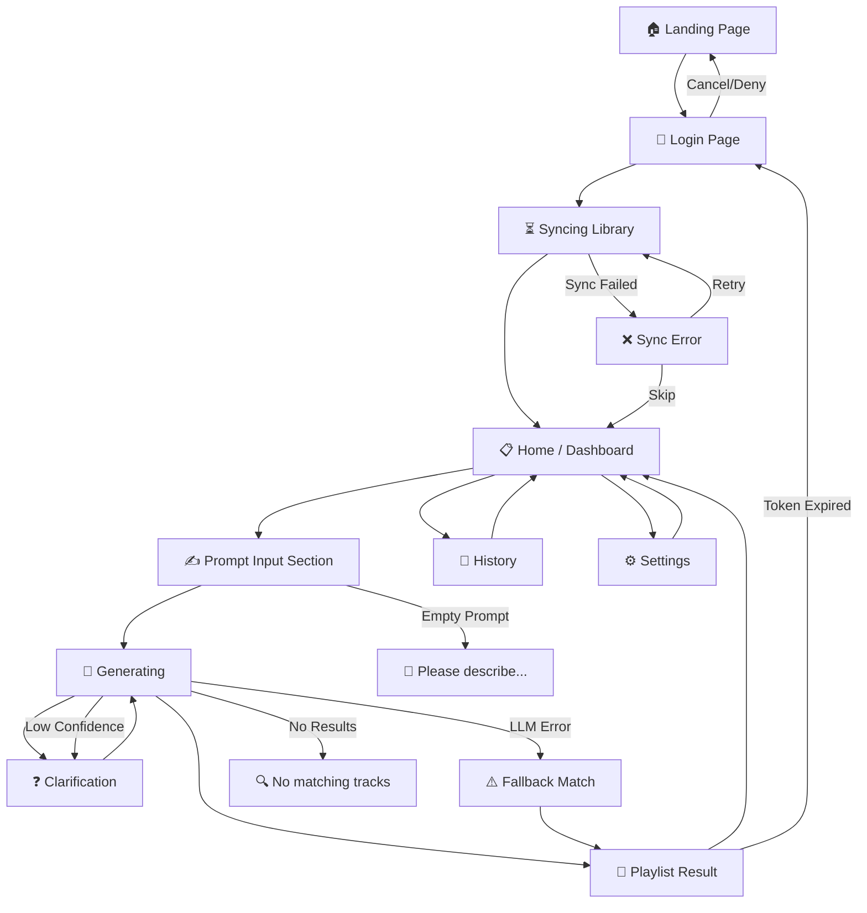

# Playlist Copilot — Information Architecture (IA)

## IA Diagram (Mermaid)



## Page Tree

```
Playlist Copilot
├── 1. Landing Page (/)
│   ├── Hero Section
│   ├── Value Proposition
│   ├── How It Works (3 steps)
│   └── CTA: "Login with Spotify"
│
├── 2. Login (/login)
│   ├── Spotify OAuth Button
│   ├── Permission Explanation
│   └── Back to Landing
│
├── 3. Syncing (/syncing)
│   ├── Progress Indicator
│   ├── "Syncing your library..." message
│   ├── Skip Button (optional)
│   └── Retry on failure
│
├── 4. Home / Dashboard (/home)
│   ├── Welcome Message
│   ├── Library Stats
│   ├── Prompt Input Area (primary action)
│   ├── Example Chips grouped by Scene / Vibe
│   ├── "Generate Playlist" Button
│   └── Recent Playlists (1 preview item + "View all")
│
├── 5. Prompt Input (section on /home, optional /home#prompt anchor)
│   ├── Large Textarea
│   ├── Character Count / Tips
│   └── Example Prompts
│
├── 6. Generating (/generating)
│   ├── "Understanding your request..." (Step 1)
│   ├── "Searching your library..." (Step 2)
│   ├── "Creating your playlist..." (Step 3)
│   ├── AI detected tags
│   ├── Clarification state for low confidence
│   └── Fun micro-interaction (music notes floating)
│
├── 7. Playlist Result (/result)
│   ├── Playlist Name + Track Count
│   ├── Track List (album art, title, artist)
│   ├── "Open in Spotify" Button (primary CTA)
│   ├── "New Prompt" Button
│   ├── Natural-language "Matched because" sentence + tags
│   └── Quick Refine placeholder (V1.1 / Coming Soon)
│
├── 8. History (/history)
│   ├── List of Past Prompts + Generated Playlists
│   ├── Date, Prompt Text, Track Count
│   ├── "Reuse Prompt"
│   └── "Open in Spotify"
│
├── 9. Settings (/settings)
│   ├── Account Info (Spotify connected as...)
│   ├── Sync Status + "Re-sync Library"
│   ├── "Disconnect Spotify"
│   └── About / Version
│
└── Error States (overlay / inline)
    ├── Token Expired → Re-login
    ├── Sync Failed → Retry / Skip
    ├── Empty Prompt → Validation Message
    ├── Low Confidence Parse → One Clarification Question
    ├── LLM Parse Error → Retry once, then Fallback Message
    ├── No Results Found → Suggestions + Try Different Description
    └── Spotify Playlist Failure → Keep track list visible + Retry
```

## IA Notes for V1

| Decision | Rationale |
|---|---|
| **Prompt input lives on Home** | The product should feel fast and direct. A separate prompt page adds an unnecessary step. |
| **Recent Playlists is a preview, not a main surface** | History exists for browsing; Home should keep attention on the next prompt. |
| **No "Save to Library" action** | The generated playlist is already created in Spotify. A separate save action may confuse users. |
| **Clarification is a state, not a new full page** | Low-confidence AI should ask one lightweight question without derailing the flow. |
| **Quick Refine is V1.1** | Useful, but not required for the MVP generation loop. |
| **Unsupported metadata should be uncertain** | Spotify Audio Features do not reliably identify vocal gender, so tags like "female vocals" should not appear as guaranteed matches in V1. |

## Global Elements

| Element | Description |
|---|---|
| **Nav Bar** | Logo (top-left), minimal nav: Home / History / Settings |
| **Footer** | "Powered by AI · Playlist Copilot · v1.0" |
| **Loading States** | Skeleton screens for lists, pulse animation for generating |
| **Error Toast** | Bottom-center toast for transient errors (sync fail, token refresh) |
| **Mobile Nav** | Bottom tab bar on mobile: Home / History / Settings |
