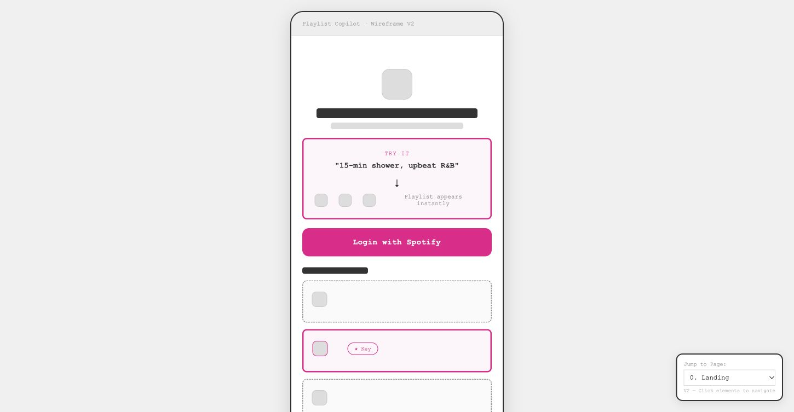

# AI Playlist Copilot

**A product and interaction-design prototype for finding music in your own Spotify library with a natural-language request.**

**See the work:** [Interactive wireframe](prototype/Wireframe_V2.html) · [Browsable front-end source](app) · [Information architecture](assets/IA_Diagram.md) · [Task flow](assets/Task_Flow.md)

## Problem and product idea

People often know the situation they are listening in—“15-minute shower, upbeat R&B” or “coffee-shop study, instrumental jazz”—without knowing the exact songs to search for. Keyword search does not capture that combination of mood, activity, and duration. AI Playlist Copilot is designed to interpret the request, retrieve fitting tracks from the listener's saved music, and explain the resulting playlist.

The focus is **personal-library retrieval**, not recommending unfamiliar music from Spotify's entire catalog.

## What I designed

- **Product definition:** Target use case, MVP scope, product requirements, and validation priorities.
- **Core journey:** Landing → Spotify authorization → library sync → prompt → generation → result → open in Spotify.
- **Supporting journeys:** Prompt history, reuse, resync, empty states, expired sessions, no results, and failed generation.
- **AI interaction:** A one-question clarification when intent is ambiguous; a short “matched because” explanation and readable tags for each result.
- **Iterations:** Information architecture, user and task flows, UX copy, low-fidelity wireframes, and a responsive interface prototype.

## MVP design logic

The proposed pipeline is: sync saved tracks → parse a request into structured constraints → search and rank the personal library → create a playlist → show a result with an explanation. When a request is unclear, the design asks for one lightweight clarification. When retrieval fails, it offers a recoverable next step instead of an unexplained empty screen. Unsupported attributes should be communicated with uncertainty rather than shown as guaranteed matches.

## What exists today

The published prototype contains a Next.js App Router and TypeScript interface with Tailwind CSS. It has responsive Landing, Login, Syncing, Home, Generating, Result, History, and Settings screens, plus mock playlists and prompt history. The flows, copy, and wireframe document the intended end-to-end behavior.

**Implementation status:** The interface is a static MVP shell. Spotify OAuth, real library sync, AI parsing, retrieval/ranking, playlist creation, and persistent history are **not integrated yet**. Demo content is mock data.

## My role

I led 0→1 product definition and interaction design, wrote the PRD and flows, designed the copy and failure states, and built the front-end prototype. The key product challenge is keeping the result aligned with the listener's intent, not merely returning tracks that seem semantically plausible.

## Repository contents

The [Next.js source](app), [components](components), and [mock data](lib/mock-data.ts) are browsable in this repository. Clone or download it, then run `pnpm install` and `pnpm dev` locally. A [source ZIP](AI-Playlist-Copilot-source.zip) is also available. It uses mock content; Spotify OAuth, library sync, AI parsing, and playlist creation are not integrated.

- [Interactive low-fidelity wireframe](prototype/Wireframe_V2.html) — download and open in a browser
- [Information architecture](assets/IA_Diagram.md)
- [Task flow](assets/Task_Flow.md) and [user flow](assets/User_Flow.md)
- [UX copy and error states](assets/UX_Copy_V2.md)
